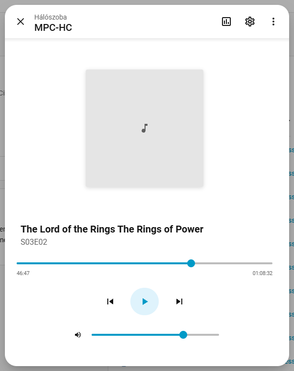
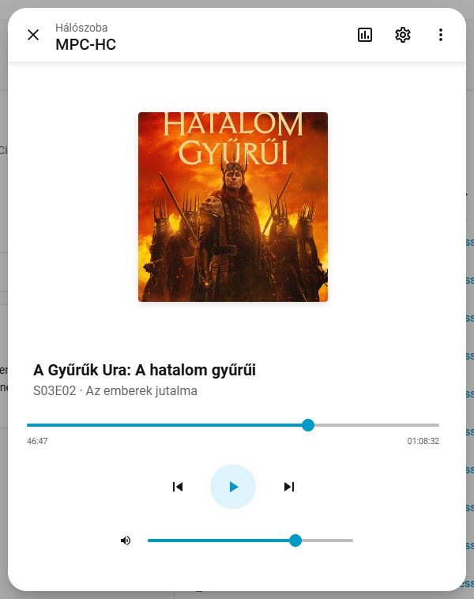
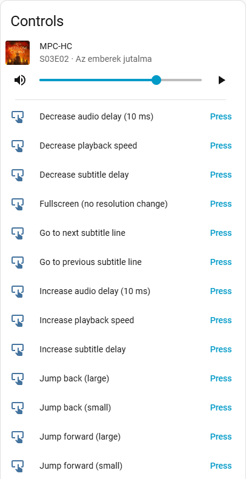
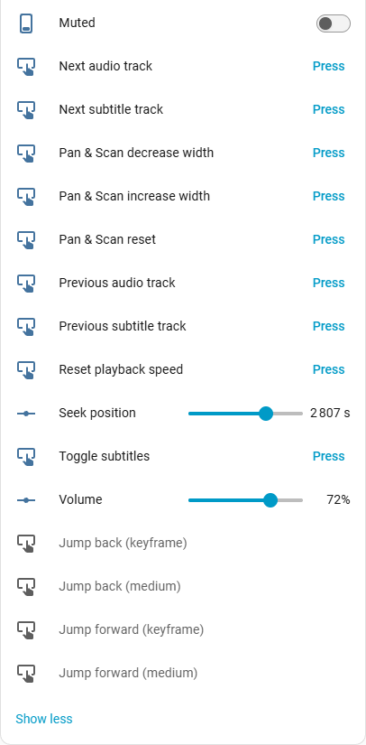
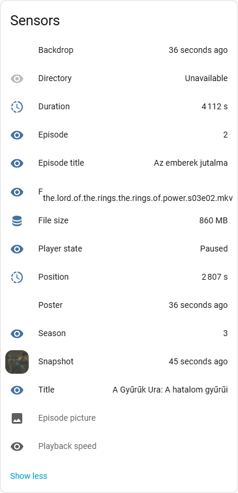
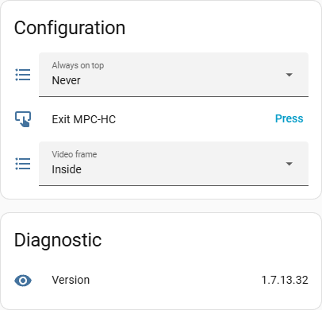
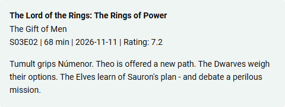

# MPC-HC for Home Assistant

[](https://github.com/szucsr/ha-mpc-hc/releases)
[](https://github.com/szucsr/ha-mpc-hc/actions/workflows/validate.yml)
[](LICENSE.md)
<!-- TODO: enable this badge once the integration shows up in the Home Assistant analytics

-->

Control and monitor Media Player Classic - Home Cinema (MPC-HC) from Home Assistant, over the player's built-in web interface. No add-on or software has to be installed on the PC besides MPC-HC itself.

- A full **media player** entity: play, pause, stop, seek, volume, mute and playlist next/previous
- The **series or movie title**, the episode code and (with TMDb) the **episode title**, poster, description, genres and rating
- **Buttons** for jumps, playback speed, audio and subtitle tracks and delays, fullscreen, Pan & Scan and more
- A **live snapshot** of the video
- **Network scan** to find the PC, several players side by side, and an action that sends **any** MPC-HC command
- Recognises title, season, episode and year from file and folder names
- English and Hungarian translations

## Table of Contents

- [Screenshots](#screenshots)
- [Requirements](#requirements)
- [Installation](#installation)
- [Set up MPC-HC](#set-up-mpc-hc)
- [Add a player](#add-a-player)
- [What you get](#what-you-get)
- [Actions](#actions)
- [File name recognition](#file-name-recognition)
- [TMDb](#tmdb)
- [Tips](#tips)
- [Troubleshooting](#troubleshooting)
- [FAQ](#faq)
- [Known limitations](#known-limitations)
- [Translations](#translations)
- [Contributing](#contributing)

## Screenshots

| **Media player without TMDb** | **Media player with TMDb** |
|:---:|:---:|
|  |  |

| **Controls** 1 | **Controls** 2 |
|:---:|:---:|
|  |  |

| **Sensors** | **Configuration** |
|:---:|:---:|
|  |  |

## Requirements

- Home Assistant 2026.11 or newer (developed and tested on 2026.11)
- MPC-HC with its **web interface enabled**, reachable from Home Assistant over the network
- Developed and tested with MPC-HC 1.7.13.32. Other versions with the same web interface should work

## Installation

### Home Assistant Marketplace

Search for **MPC-HC** in the Home Assistant Marketplace and install it. Home Assistant offers to set it up right away, no restart needed.

<!-- TODO: check the wording and the steps of the Marketplace listing when the integration is published -->

### Manual

1. Download this repository.
2. Copy the `mpc_hc` folder from the repository into the [`custom_components` folder](https://developers.home-assistant.io/docs/creating_integration_file_structure/#where-home-assistant-looks-for-integrations) of your Home Assistant configuration.
3. Restart Home Assistant.

Then [set up MPC-HC](#set-up-mpc-hc) and [add a player](#add-a-player).

## Set up MPC-HC

On the PC that runs MPC-HC, once:

1. Open **View → Options → Player → Web Interface**.
2. Tick **Listen on port** and set the port (default **13579**).
3. **Untick "Allow access from localhost only".** While it is ticked, only the PC itself can reach the web server, not Home Assistant.

### Security

> [!WARNING]
> The MPC-HC web server has **no authentication and no encryption**. After lifting the localhost restriction, anyone who can reach the port can control the player and see its snapshot. Do not expose the port to the internet.

Allow the port in the Windows firewall only for the Home Assistant machine, for example (PowerShell, run as administrator, with your Home Assistant's address):

```powershell
New-NetFirewallRule -DisplayName "MPC-HC web interface (Home Assistant)" `
  -Direction Inbound -Protocol TCP -LocalPort 13579 `
  -RemoteAddress 192.168.1.10 -Action Allow
```

## Add a player

[](https://my.home-assistant.io/redirect/config_flow_start?domain=mpc_hc)

Or go to **Settings → Devices & services → Add integration → MPC-HC**, then choose how to add the player:

- **Scan the network.** Home Assistant checks the networks it is connected to (at most one /24 range per network adapter) for an MPC-HC web interface on the port you give (default 13579). It takes a few seconds. Players that are already added are not offered again.
- **Enter the address manually.** Give the IP address or host name and the port.

You also choose a **name** (default "MPC-HC"). It becomes the device name and the start of the entity IDs, for example *MPC-HC Living room*.

> [!NOTE]
> Pick the name carefully: entity IDs are created once and do not follow a later rename.

You can add **several players**, each one with its own device and entities.

If the PC gets a new hostname or IP address, open the three-dot menu of the entry and choose **Reconfigure** ([integration settings](https://my.home-assistant.io/redirect/integration/?domain=mpc_hc)). The name, host and port can be changed, and the entities and their history are kept.

## What you get

### Media player

The media player entity has the name of the device (for example `media_player.mpc_hc`).

| | |
|---|---|
| **States** | `playing`, `paused`, `idle` (stopped or no file) and `unavailable` (PC off, MPC-HC closed) |
| **Controls** | Play, pause, play/pause, stop, seek, volume set and step, mute, next and previous file in the playlist |
| **First line** | The series or movie title (TMDb's spelling when matched, otherwise recognised from the file name) |
| **Second line** | TV: the episode code and the episode title, for example `S03E03 · The Secret Fire`. Movies: the year |
| **Picture** | The poster from TMDb (when TMDb is set up) |

The second line is delivered in the `app_name` attribute, and TV episodes are reported with the content type `video` instead of `tvshow`. This is on purpose: for `tvshow` the Home Assistant frontend builds its own second line from the series title, season and episode, which would only repeat the title. Use the **Season** sensor or the `media_series_title` attribute in automations to tell series from other videos.

Attributes (always present while something is loaded; empty when unknown):

| Attribute | Content |
|---|---|
| `media_series_title`, `media_season`, `media_episode` | Series title, season and episode (TV only) |
| `year`, `resolution`, `source`, `languages` | Recognised from the file name, for example `1999`, `1080p`, `webrip`, `["hu", "en"]` |
| `tmdb_status` | `matched`, `unmatched`, `pending`, `disabled` or `error` (see [TMDb](#tmdb)) |
| `overview`, `genres`, `rating`, `release_date` | From TMDb: description of the episode (or movie), genres, rating (0 to 10), air or release date |
| `tmdb_id`, `imdb_id` | Identifiers, for example for linking to other services |

### Other entities

| Platform | Entities |
|---|---|
| **Sensor** | **File** (attributes: `directory`, the name of the folder, and `path`, the full path on the PC) · **Player state** · **Position** (seconds, rounded down to 5 s while playing, exact when paused) · **Duration** (seconds) · **File size** (MB, with the exact `bytes` as an attribute) · **Title**, **Season**, **Episode** (recognised from the file name; the title uses TMDb's spelling when matched) · **Episode title** (TMDb) · **Playback speed** (disabled by default, see [limitations](#known-limitations)) · **Version** (diagnostic) |
| **Switch** | **Muted**, which follows the real mute state of the player |
| **Number** | **Volume** (0 to 100 %) · **Seek position** (seconds; the maximum is the length of the file) |
| **Select** | **Video frame** (Normal, Inside, Stretch) · **Always on top** (Never, Always, While playing, While playing video). Both are in the configuration category and show the last option chosen from Home Assistant, because MPC-HC does not report them |
| **Image** | **Snapshot** (the current video frame) · **Poster** · **Backdrop** · **Episode picture** (disabled by default) |
| **Button** | **Jumps:** small, large, to the beginning (medium and keyframe jumps are disabled by default) · **Playback speed:** faster, slower, reset · **Audio:** previous and next track, delay -10 ms and +10 ms · **Subtitles:** on/off, previous and next track, previous and next subtitle line, delay decrease and increase · **Fullscreen** (without changing the display resolution) · **Pan & Scan:** reset, increase and decrease width · **Exit MPC-HC** (configuration category) |

Step sizes (jumps, subtitle delay, volume steps and playback speed steps) are the ones set in MPC-HC's own options.

The names of the entities follow the language of Home Assistant (English and Hungarian are included).

## Actions

### `mpc_hc.send_command`

Sends any MPC-HC command code (`WM_COMMAND`) to a player. Everything the web interface can do is available this way, even without a button.

```yaml
action: mpc_hc.send_command
target:
  entity_id: media_player.mpc_hc
data:
  command: 956   # subtitles on/off
```

A selection of useful codes (from MPC-HC 1.7.13.32):

| Code | Command | Code | Command |
|---|---|---|---|
| 887 / 888 / 889 / 890 | Play / Pause / Play/Pause / Stop | 956 | Subtitles on/off |
| 919 / 920 | Previous / next file | 2302 | Reload subtitles |
| 921 / 922 | Previous / next | 32780 / 32781 | Previous / next subtitle line |
| 996 | Jump to the beginning | 24000 / 24001 | Subtitle delay - / + |
| 897 / 898 | Jump to previous / next keyframe | 905 / 906 | Audio delay +10 ms / -10 ms |
| 899 to 904 | Jumps (small, medium, large) | 952 / 953 | Next / previous audio track |
| 894 / 895 / 896 | Slower / faster / reset speed | 954 / 955 | Next / previous subtitle track |
| 33449 / 33450 / 33451 | Repeat forever / file / playlist | 830 / 831 | Fullscreen / fullscreen without resolution change |
| 835 to 840 | Video frame (half, normal, double, stretch, inside, outside) | 883 to 886 | Always on top (never, always, while playing, while playing video) |
| 861 to 876 | Pan & Scan (reset, size, width, height, move) | 816 | Exit MPC-HC |
| 947 | After playback: play the next file in the folder | 915 | After playback: shut the PC down |

The complete list is on the player's own page, `http://<PC address>:13579/index.html`. Codes can differ between MPC-HC versions. Use `Exit` and the "After playback" commands with care.

### `mpc_hc.set_tmdb_id`

Corrects a wrong TMDb match for the file that is playing. See [Correcting a wrong match](#correcting-a-wrong-match).

## File name recognition

The title, season, episode and year are recognised from the file name, with the name of its folder as a fallback. No internet access is needed for this.

- A name that cannot be recognised is not guessed: it is shown as a plain title, and TMDb is not asked.
- Not recognised: date-based episodes (`2024.03.15`), anime-style names (`[Group] Show - 05`) and three-digit episode numbers (`105`).

## TMDb

With a free TMDb token the integration adds the **episode title, poster, backdrop, episode picture, description, genres, rating, release date and the TMDb and IMDb identifiers**. Without a token everything else works as described above.

### Set up

1. Create a free account at [themoviedb.org](https://www.themoviedb.org) and copy the **API Read Access Token** from the API page of your settings. A v3 API key works as well.
2. In Home Assistant open the integration and choose **Configure** on any player.
3. Paste the token. It is checked with a test request before it is saved.

The token and the language are saved **once** and shared by all players. Optionally set the **language** (for example `hu-HU` or `en-US`); by default the language of Home Assistant is used. Where a description is missing in that language, the English one is used.

### How it works

- A lookup runs in the background when a new file starts, so the polling of the player is never delayed. Until the answer arrives, the values recognised from the file name are shown.
- The recognised title is matched to a TMDb series or movie. A result is accepted only if its title is very close (or equal) to the recognised one; among those, the year and the popularity decide. If nothing fits, nothing is shown, and `tmdb_status` is `unmatched`.
- Answers are cached for 30 days (misses for one day), so a file that was seen before needs no request.
- Pictures are downloaded by Home Assistant (poster 500 px, backdrop 780 px, episode picture 300 px wide), your browser never talks to TMDb.

`tmdb_status` (an attribute of the media player):

| Value | Meaning |
|---|---|
| `matched` | The metadata is shown |
| `pending` | The lookup is running |
| `unmatched` | TMDb has no good match for this file |
| `disabled` | No token is saved |
| `error` | TMDb could not be reached or rejected the token (see the log) |

### Correcting a wrong match

A remake, a foreign title or an unusual spelling can lead to a wrong or missing match. While the file plays, call:

```yaml
action: mpc_hc.set_tmdb_id
target:
  entity_id: media_player.mpc_hc
data:
  tmdb_id: 1234
  media_type: tv        # tv or movie
  scope: series         # series: every file with this title, file: only this file
```

The ID is the number in the TMDb address of the item, for example `themoviedb.org/tv/1234-show-name` means ID 1234. Call the action again **without** `tmdb_id` to remove a correction. Corrections survive restarts.

### What is sent and stored

- TMDb receives the recognised title, the year, the season and episode numbers and your token. Nothing else about the file or your system is sent (TMDb sees the address of your Home Assistant, like any web service).
- The token, the language and your corrections are stored in `.storage/mpc_hc.settings`, the cache in `.storage/mpc_hc.tmdb_cache`. The token is stored as plain text: do not commit the `.storage` folder or share it with backups that others can read.

### Attribution

This product uses the TMDB API but is not endorsed or certified by <a href="https://themoviedb.org"></a>.

## Tips

### Refresh on demand

The player is polled every 2 seconds while it plays and every 10 seconds otherwise. To refresh a player right away, for example from an automation, update its media player entity:

```yaml
action: homeassistant.update_entity
target:
  entity_id: media_player.mpc_hc
```

### Keep the busy entities out of the database

The position, the seek slider and the snapshot change every few seconds while playing. They are useful live, but the history is rarely needed. Add to your `configuration.yaml` (the entity IDs start with the device name you chose, adjust the part `mpc_hc`):

```yaml
recorder:
  exclude:
    entity_globs:
      - sensor.mpc_hc*_position
      - number.mpc_hc*_seek_position
      - image.mpc_hc*_snapshot
```

Check the exact IDs in **Settings → Entities**: they follow the language Home Assistant had when the entities were created.

### Length as hours and minutes

```jinja


  {{ '%02d:%02d' | format(s // 3600, s % 3600 // 60) }}

  –

```

### Lovelace markdown card template

</a>

```jinja2














{% set ep_code = 'S%02dE%02d' | format(season, episode) if season >= 0 and episode >= 0 else '' %}



  


  


  


  




Nothing playing right now.

**{{ title }}**
{{ ep_title }}
{{ meta_line }}

  {{ overview }}

```

### Lights follow the player

```yaml
automation:
  - alias: "Living room lights follow MPC-HC"
    triggers:
      - trigger: state
        entity_id: media_player.mpc_hc
        to: "playing"
    actions:
      - action: light.turn_off
        target:
          entity_id: light.living_room
  - alias: "Living room lights on when MPC-HC pauses"
    triggers:
      - trigger: state
        entity_id: media_player.mpc_hc
        to: "paused"
    actions:
      - action: light.turn_on
        target:
          entity_id: light.living_room
        data:
          brightness_pct: 30
```

## Troubleshooting

First check what the player's web interface answers. From the machine that runs Home Assistant:

```bash
curl -v --max-time 5 http://<PC address>:13579/variables.html
```

| What you see | Meaning and fix |
|---|---|
| The request times out | The PC is off, MPC-HC is not running, or the firewall drops the connection. Check the firewall rule |
| Connected, then *Connection reset by peer* | **"Allow access from localhost only" is still ticked** in MPC-HC (View → Options → Player → Web Interface) |
| A page with `<p id="version">` | The web interface works, the problem is in Home Assistant: check the log |

| Problem | Fix |
|---|---|
| The network scan finds nothing | The PC must be on, MPC-HC running with the web interface on, the firewall must allow the port, and the PC must be in a network that Home Assistant is connected to (VLANs and Docker networks are not scanned). Use manual entry otherwise |
| The scan says that "something accepts connections and closes them" | Probably MPC-HC with the localhost restriction still on |
| All entities are `unavailable` | The PC is off or MPC-HC is closed. They come back by themselves a few seconds after the player is up |
| No TMDb data | See `tmdb_status`. `disabled`: no token. `error`: check the token and the log. `unmatched`: use `mpc_hc.set_tmdb_id` |
| The snapshot is black | The snapshot is taken by MPC-HC, and with some video renderers it comes out black. Open `http://<PC address>:13579/snapshot.jpg` in a browser: if it is black there too, it is the player |
| Always on top or Video frame shows the wrong value | MPC-HC does not report them, so Home Assistant shows the last option chosen from Home Assistant, and **Never** and **Inside** after a restart |

For details, enable debug logging:

```yaml
logger:
  logs:
    custom_components.mpc_hc: debug
```

### Reporting a problem

When you open an issue, please include:

- the versions of Home Assistant and MPC-HC
- the output of the `curl` command above
- the log lines of `custom_components.mpc_hc` with debug logging on (see above), from the moment of the problem
- the `tmdb_status` attribute, if the problem is about TMDb data

Logs and facts get you help much faster than a description alone.

## FAQ

**Q: How do I change the IP address, port or name of a player?**

**A:** Open the three-dot menu of the entry in the [integration settings](https://my.home-assistant.io/redirect/integration/?domain=mpc_hc) and choose **Reconfigure**. The entities and their history are kept. The entity IDs do not change when the name changes.

---

**Q: How do I add, change or remove the TMDb token later?**

**A:** Choose **Configure** on any player of the integration. To remove the token, tick "Remove the saved token". The change applies to all players.

---

**Q: My Home Assistant is in Hungarian, but the entity names and the TMDb data are English. Why?**

**A:** Home Assistant has two language settings. The names of the entities and the default language of the TMDb data follow the **system language** (Settings → System → General); the language of your profile only changes the look of the interface. Set the language of the TMDb data separately under **Configure** (for example `hu-HU`). Genre names are shown as TMDb provides them, and some are not translated by TMDb.

---

**Q: Does it work with MPC-BE or other forks of MPC-HC?**

**A:** It was developed and tested with MPC-HC 1.7.13.32 only. A player that has the same web interface (the pages `variables.html` and `command.html`) may work, but it is untested. Reports are welcome.

## Known limitations

- **The web interface has no login.** See [Security](#security).
- **Playback speed:** MPC-HC always reports 1 in its web interface, so the **Playback speed** sensor is disabled by default. The speed buttons work.
- **Audio and subtitle tracks** can only be cycled (previous and next). The web interface gives no list of tracks or the current one.
- **Video frame and Always on top** are not reported by MPC-HC (see above).
- **Files are not opened** from Home Assistant: the web interface has no way to start a file by path.
- The state is polled every 2 seconds while playing and every 10 seconds otherwise. Commands refresh it right away.
- The position and the seek slider move in steps of 5 seconds while playing.

## Translations [](https://crowdin.com)

The integration is available in English and Hungarian. Do you want to add a language or improve one? The translations are managed on Crowdin, which makes it easy to contribute.
[Translate this integration on Crowdin](https://crowdin.com/project/ha-mpc-hc/invite?h=88ef6fc89841c28aa46ee0d44850be032951041)

## About MPC-HC

MPC-HC is a free media player for Windows. This integration is not affiliated with the MPC-HC project.

## Contributing

Issues and pull requests are welcome. Please read the [AI policy](AI_POLICY.md) before you contribute.

## License

[MIT](LICENSE.md)
